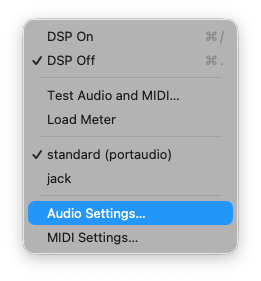
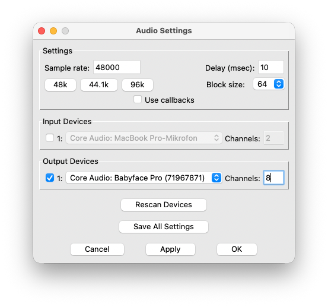
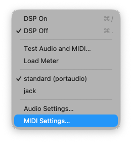
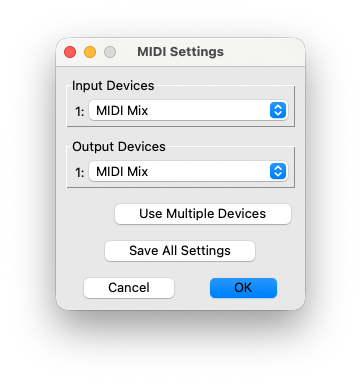
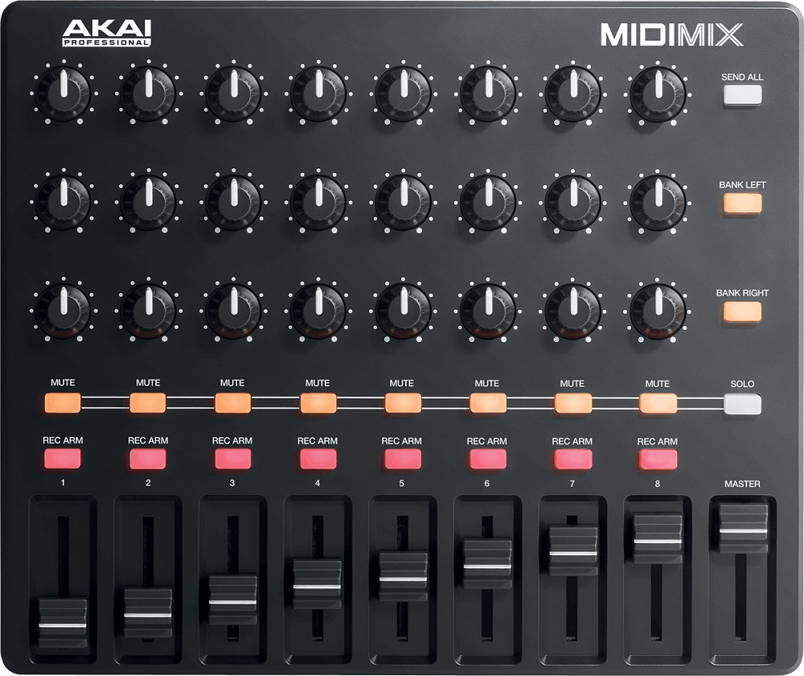
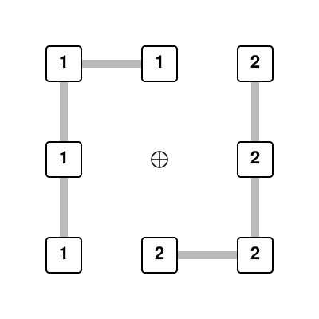
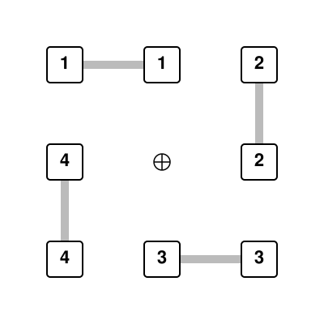
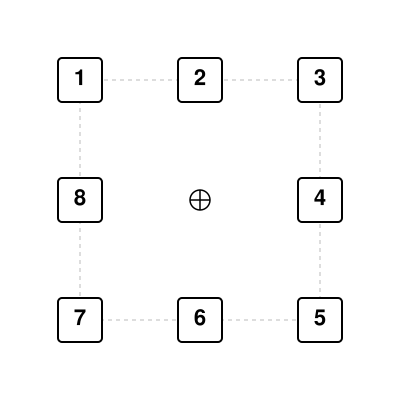

# ab-rubin

### Rubin
Achim Bornhoeft © 2026 
(bass)flute, (bass)clarinet, piano, violin, violoncello | electronics (4ch) 
[www.bornhoeft.org/works/rubin](https://www.bornhoeft.org/works/rubin/)

## TOC

- [Live Electronics](#live-electronics)
- [Computercomposition](opmo/Rubin.md)

## Live Electronics

Made with [Pure Data](https://puredata.info) (PD-vanilla, Version PD-0.56-2) 

### Installation / Setup

- Download Pure Data Vanilla from [https://puredata.info/downloads/pure-data](https://puredata.info/downloads/pure-data)
- Download the newest version of the patch including the Audio.zip archive from [https://github.com/bornhoeft/ab-rubin/releases](https://github.com/bornhoeft/ab-rubin/releases)
- Extract the audio files and place them in the "tracks" subdirectory

### Open Patch 
Open @main.pd in Puredata

### Audio Setup 

Select Media - Audio Settings...

1. Set the Samplingrate to 48000.
2. Set Delay (msec) to 10.
3. Select the Audio Interface
4. Set Channels to 8

### MIDI Setup (Akai MidiMix)
 
Select Media - Midi Settings...

1. Select the MIDI Mix under Input Devices
2. Select the MIDI Mix under Output Devices

### Akai MidiMix

1. row: KNOBS for 8ch playback strings
2. row: KNOBS for frequency modulation strings
3. row: KNOBS for frequency modulation harmonics (instrument pitches)
4. row: ~~MUTE toggles~~
5. row: ~~REC ARM toogles~~
6. row: FADER for output channels 1-8 (row 1 - 3), FADER 9 (MASTER) for main volume

### Select Loudspeaker Setup

#### 2 speaker (stereophonic)

#### 4 speaker (quadrophonic)

#### 8 speaker (octophonic)

### Test Loudspeaker setup (2,4, or 8 channels)

1. Press "o" to switch DSP on or click toggle.
2. Switch Test on (1) and off (0)

### Select manual or automatic fader/knob movements

Switch between manual (0) and automatic (1).
(With no Akai MidiMix the select the automatic movments of the fader.)

### Amplification of the instruments

If necessary (e.g., in larger concert halls), amplify all instruments and distribute their sound to the front-row speakers according to their positions on stage.

### Start Patch

1. Press "o" to switch DSP on or click toggle.
2. Adjust the Master Fader to the appropriate output level 
3. Press spacebar to start the session. (It should start with Mark 1, Measure 1)
3. Press spacebar again at each rehearsal mark.

#### Rehearsal Marks in score
- [ 1 ] Measure 1
- [ 2 ] Measure 43
- [ 3 ] Measure 67
- [ 4 ] Measure 98
- [ 5 ] Measure 148
- [ 6 ] Measure 177

### Jump to rehearsal mark

1. Press "m" to mute playback and FM.
2. Select rehearsal mark with number keys 1 - 6.
3. Press spacebar to start at relevant rehearsal mark.