# Rubin

Oct 27, 2026 · @Achim Bornhoeft

---

The patch builds a 100-event, 11-part piece for 13 instrumental voices in two independent passes — a quantized duration stream, then a harmonic-series pitch field — before the two are recombined instrument by instrument and a parallel index stream is exported for Pure Data.

(Made with [Opusmodus](http://www.opusmodus.com) Version 4.0.33573)

## Structure of programming process

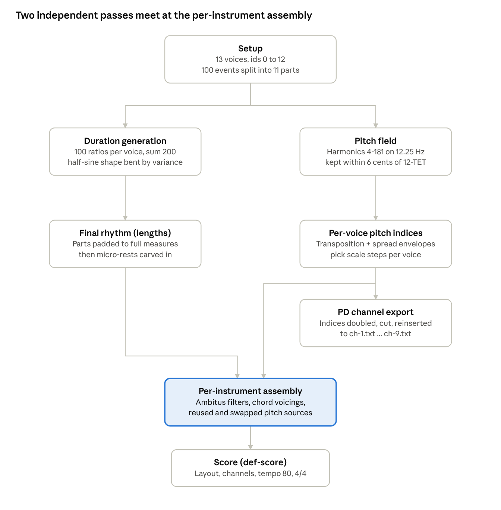

The duration and pitch passes share no data except the number of events until they meet at the per-instrument assembly, where lengths, ambitus ranges and (often reused or swapped) pitch sources are wired together; the pitch-index stream also branches off on its own, straight into the Pure Data export.

## Voices and the eleven-part form

Thirteen voices and an eleven-part form are fixed right after the seed, before any generation runs; every later duration and pitch stage divides its output along these same eleven part boundaries.

| id | variable | instrument |
| --- | --- | --- |
| 0 | vn-high-id | Violin, high |
| 1 | b-fl-id | Flute / Bass Flute |
| 2 | vn-low-id | Violin, low |
| 3 | eorg-high-id | E-Organ, high (chords) |
| 4 | b-cl-id | Clarinet / Bass Clarinet |
| 5 | ebow-id | E-Bow |
| 6 | vc-high-id | Violoncello, high |
| 7 | vc-low-id | Violoncello, low |
| 8 | eorg-low-id | E-Organ, low |
| 9 | pno-high-id | Piano, high |
| 10 | pno-chord-id | Piano, chords |
| 11 | pno-low-id | Piano, low |
| 12 | vibr-id | Vibraphone |

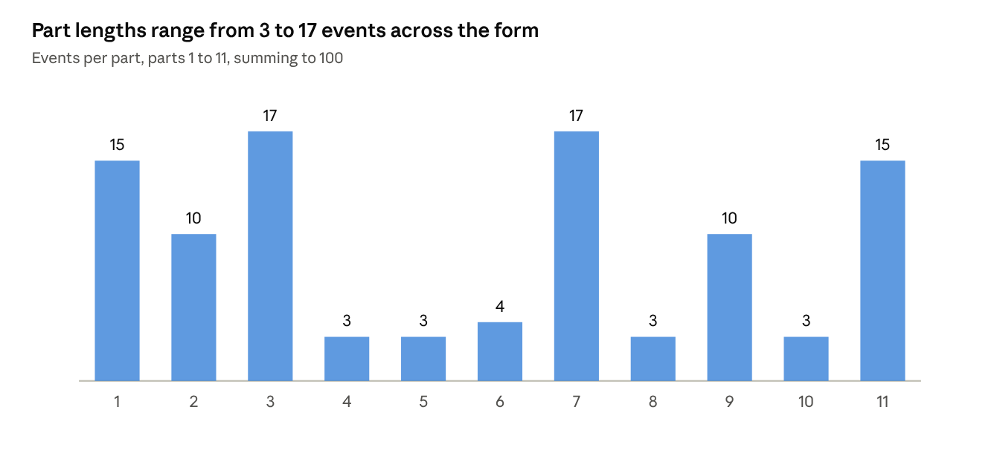

The same eleven-part boundaries later gate the duration grid, the Pure Data export, and the pitch-index streams alike.

## Shaping durations: the fit-sum engine

Every voice's duration stream comes from the same small toolkit — `grid-unit`, `fix-rounding`, `check-sum-range` and `fit-sum` — defined once at the top of the patch and reused throughout.

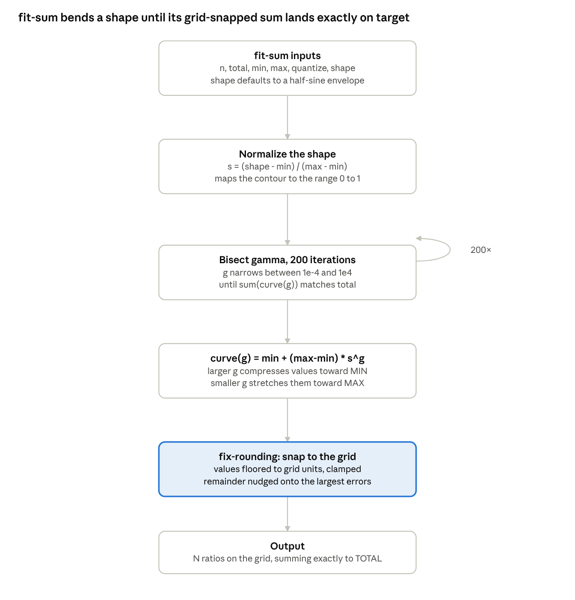

`fit-sum` is the generator actually called for durations: 100 events per voice, summing to 200, on a grid as fine as a sixteenth, between a half-note and three quarter-notes long, bent through `gen-tendency` into a half-sine shape with each voice's own variance:

```lisp
(fit-sum events 200
         :quantize '(1 2 4 8 16)
         :min 1/2 :max 3
         :shape (vector-map
                 (gen-tendency events
                   (gen-integer 1 events)
                   :variance var)
                 (half-sine events 1
                             :phase 180)))
```

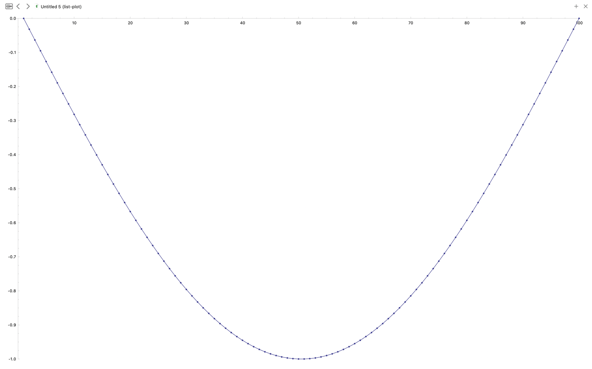

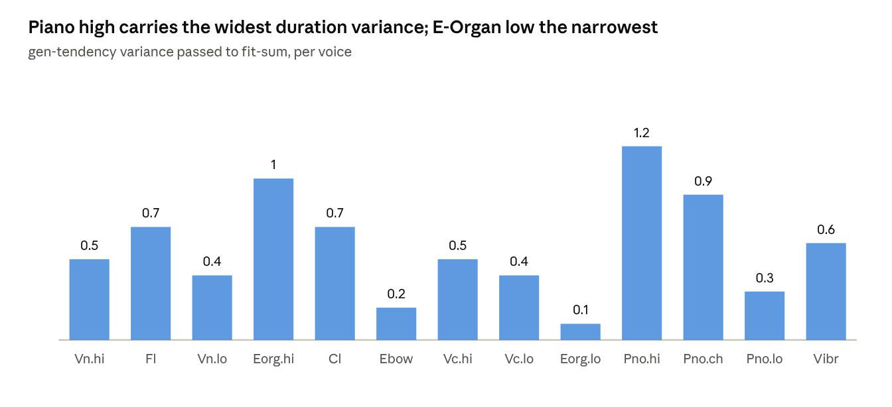

A wider variance does not change how many events a voice gets — every voice still has exactly 100 — only how unevenly `gen-tendency` jitters the half-sine envelope that `fit-sum` then bends to fit.

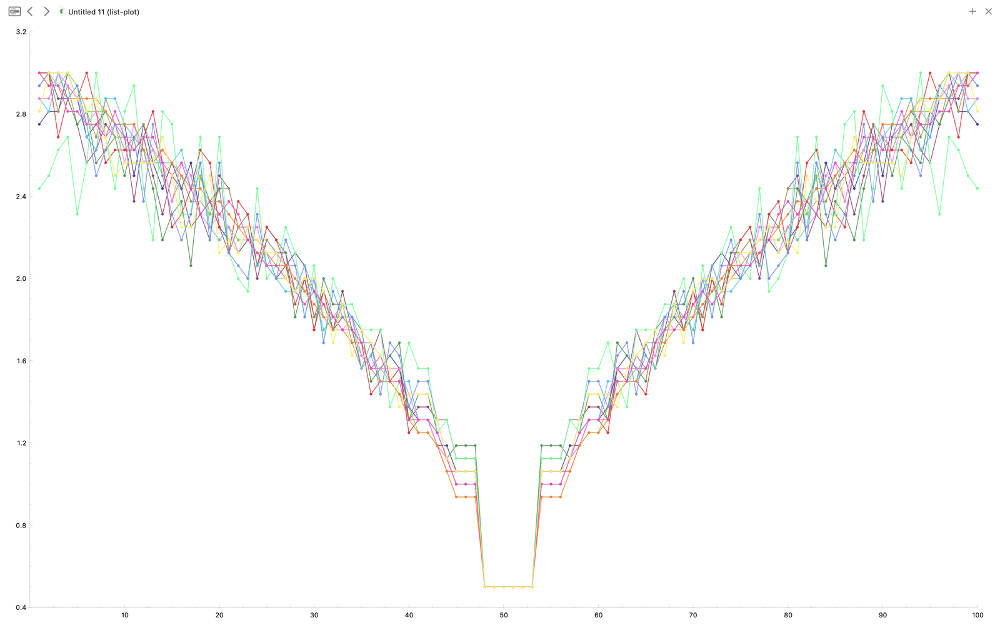

## From raw duration streams to the final rhythm

The 100-event duration stream becomes the final rhythm in three more steps: the eleven parts re-group it, the shortest voices in each part are padded out to match the longest, and a small rest is shaved off the front of almost every note.

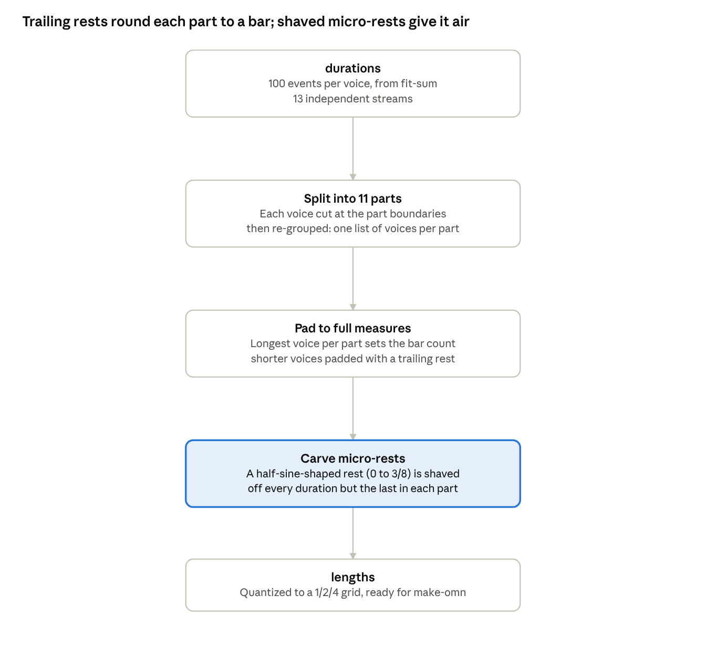

The rest shaved off each duration comes from the same half-sine shape used throughout the patch, this time sized to the number of durations minus the number of parts (one `rests-vector` value for every duration except the last in each part) and mapped onto six fixed lengths, `'(0 1/16 1/8 3/16 1/4 3/8)`. The subtraction and reinsertion happens in one pass over each voice's part:

```lisp
(loop for k in (butlast (first j))
      for r in re
      append (list (- k r) (* -1 r))
        into reslis
      finally
        (return
         (flatten
          (list reslis
                (last (first j))
                (second j)))))
```

A negative value here is a rest; the final `quantize` call (grid `'(1 2 4)`) rounds everything that remains to a notatable length.

## The harmonic pitch field

Durations finished, the patch turns to pitch: every note in every voice is restricted to harmonics of a 12.25 Hz fundamental (two octaves below `g0`) that land within 6 cents of the ordinary chromatic scale.

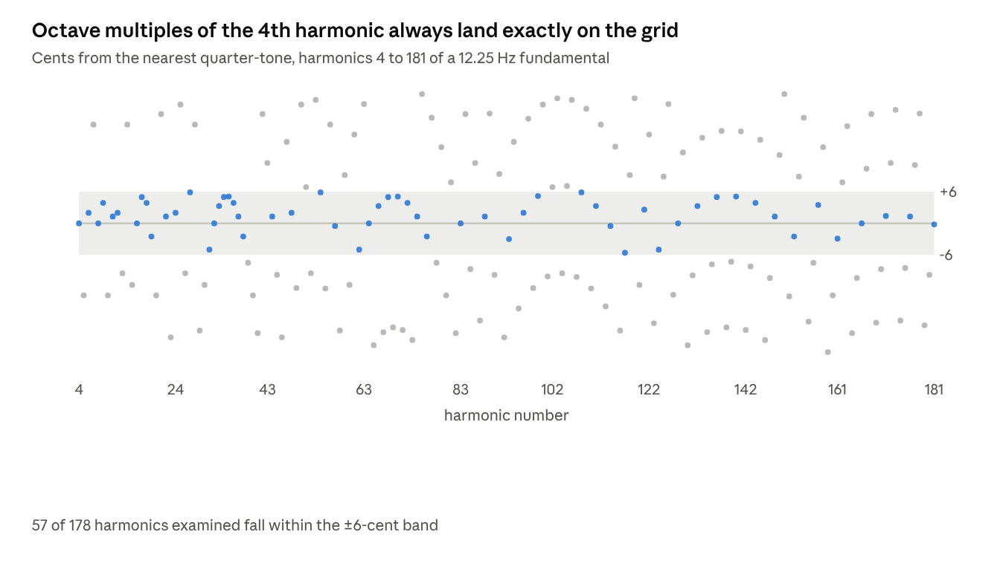

`harmonics` walks 178 overtones, the 4th through the 181st; `hertz-to-midi` quantizes each to the nearest quarter-tone (`:quantize 1/2`) while separately keeping the remainder in cents; `harm-midis` keeps only the harmonic index, quantized pitch and remainder where that remainder is within ±6 cents; and `pitch-mat` is that filtered list converted to pitch names. Reconstructing the same formula independently keeps 57 of the 178 harmonics examined. The patch's own comment says 33 — worth a quick check of `(length pitch-mat)` next time the buffer is evaluated, since the gap could mean an earlier version of this filter, a different `start-id`, or a tie-breaking rule inside Opusmodus's `hertz-to-midi` that a from-scratch reimplementation can't see.

`cents` carries the leftover deviation (via `cent-to-attribute`) into the score as microtonal articulation marks, so the fraction of a semitone an accepted harmonic still misses equal temperament by is notated, not discarded.

## Spreading and transposing the field across voices

`pitch-mat` is a single scale; turning it into simultaneous voices is the job of `spread-develop`, and only nine voices — the spread envelope and `voice-ids` are both built for exactly 9 streams, not 13.

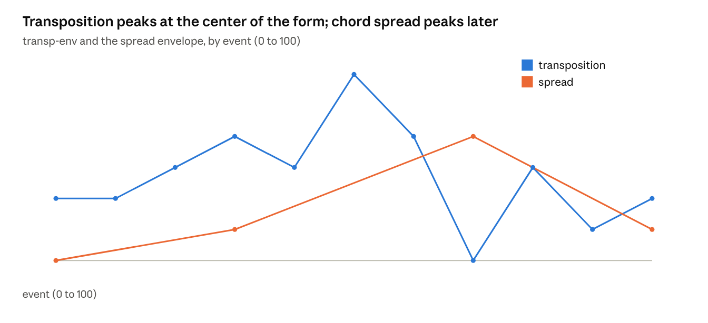

Two envelopes drive every event: `transp-env` adds an overall transposition (0 to 6 scale-steps, peaking mid-form at event 50), and the spread envelope scales a 0-to-8 ramp across those nine voices into how far apart they sit — unison at the start, drifting wide by event 70, then narrowing again. A touch of noise (`:variance 0.02`) keeps the nine columns from moving in perfect lock-step. `integer-transpose` adds the two together event by event, and `(reverse (matrix-transpose indexes))` turns the result into `voice-ids`: nine index streams, high to low.

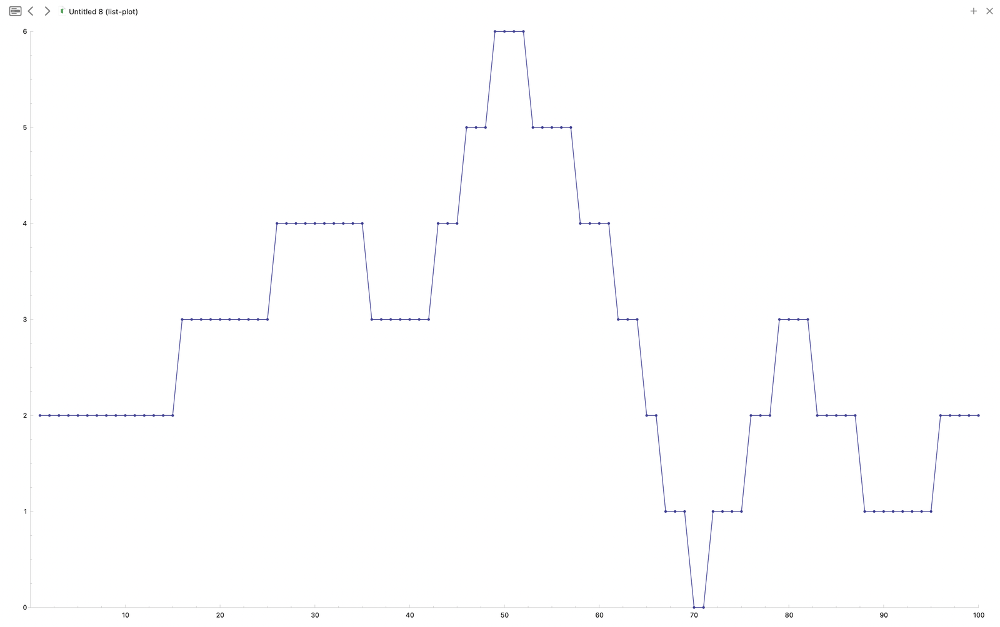

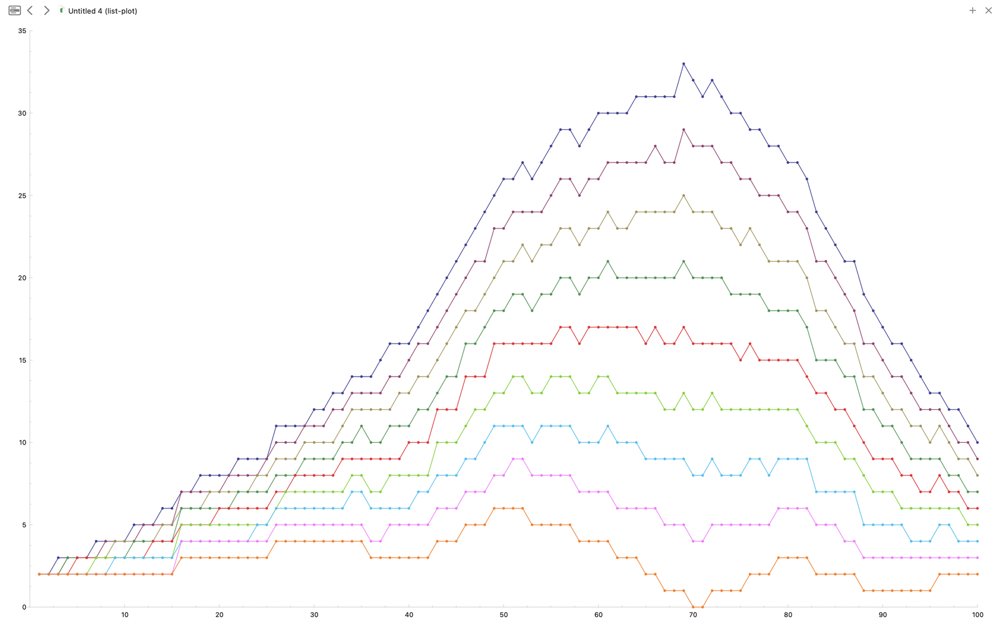

Because `voice-ids` only has nine entries, four instruments — piano's chord and low staves, and the vibraphone — can never read their own id (9, 10, 11 or 12) back out of it. Every one of them instead draws on one of the nine, directly or by building a chord from its index stream; which voice supplies which instrument is laid out in the per-instrument table below.

## Exporting pitch-index streams to Pure Data

Alongside the notated score, the same nine `voice-ids` streams are reshaped into plain-text index lists for a parallel Pure Data layer — the raw scale-degree numbers, not pitch names, one semicolon-separated file per stream.

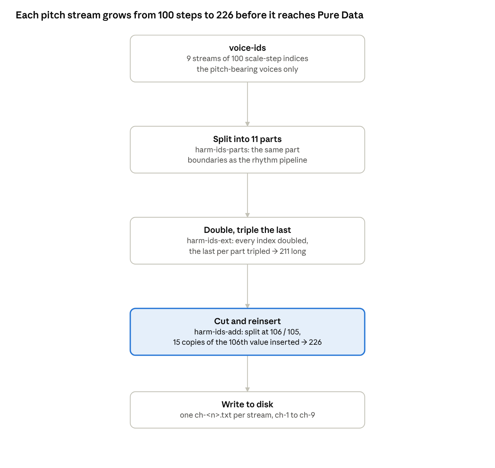

The doubling and final tripled value likely exist to give Pure Data a retrigger or crossfade point on every step rather than a single instantaneous change; the 106/105 cut and 15-step insert then stretches the middle of the stream, independently of anything happening in the notated score — this export shares the eleven-part boundaries with the rhythm pipeline, but none of its own timing.

## Per-instrument assembly

Sixteen final parts draw on thirteen duration streams but only nine pitch streams. Five parts — Piano's three staves and both vibraphone lines — get their rhythm from one id and their pitch from a different one; E-Organ's two parts and Piano's chord stave build a hand-rolled chord directly from a voice's index stream rather than reading the plain `pitches` list.

| Part | Duration id | Pitch source | Range filter |
| --- | --- | --- | --- |
| Flute | b-fl-id (1) | own stream (id 1) | e4–cs7 |
| Bass Flute | b-fl-id (1) | id 1, same as flute | c3–eb4 |
| Clarinet | b-cl-id (4) | own stream (id 4) | gs4–f6 |
| Bass Clarinet | b-cl-id (4) | id 4, same as clarinet | g2–g4 |
| Vibraphone, low | vibr-id (12) | chord built from id 2 (violin low) | instrument range |
| Vibraphone, high | vibr-id (12) | chord built from id 2 (violin low) | instrument range |
| E-Bow | ebow-id (5) | own stream (id 5), then a 6-note hexachord | d3–a4, then restricted |
| Piano, high | pno-high-id (9) | id 1 (flute) — not its own id 9 | e4–c8 |
| Piano, chords | pno-chord-id (10) | chord built from id 4 (clarinet) — not id 10 | — |
| Piano, low | pno-low-id (11) | id 8 (E-Organ low) — not its own id 11 | — |
| E-Organ, high | eorg-high-id (3) | chord built from its own id 3 | c2–fs8 |
| E-Organ, low | eorg-low-id (8) | chord built from its own id 8 | c2–fs8 |
| Violin, high | vn-high-id (0) | own stream (id 0) | instrument range |
| Violin, low | vn-low-id (2) | own stream (id 2) — also feeds the vibraphone | instrument range |
| Cello, high | vc-high-id (6) | own stream (id 6) | instrument range |
| Cello, low | vc-low-id (7) | own stream (id 7) | instrument range |

E-Organ's high and low parts are filtered to the same written range, c2–fs8; nothing elsewhere narrows them apart.

## Score layout and output

`def-score` lays out the sixteen final staves in five systems and renders them at tempo 80, 4/4, a chromatic key signature, with `:flexible-clef t` letting each staff pick whatever clef best fits what lands on it.

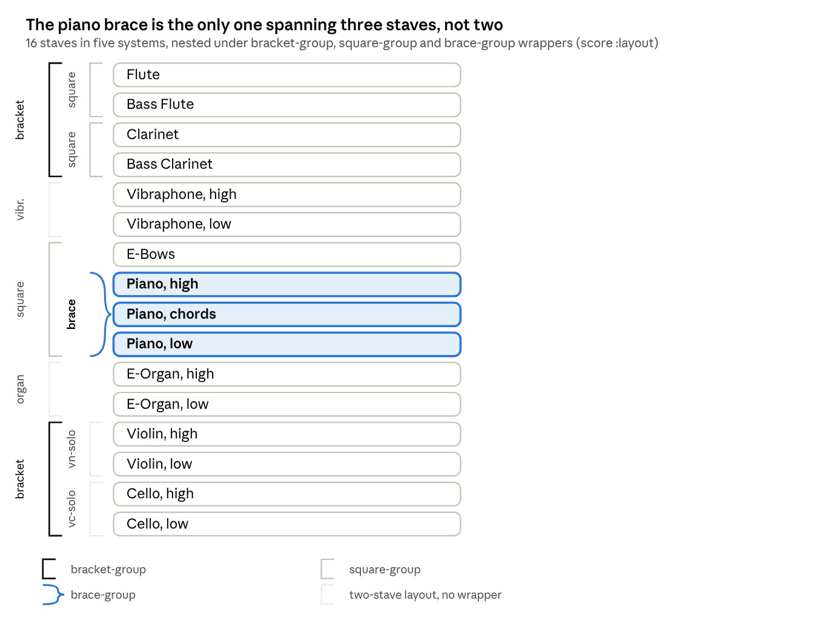

Two of the five systems get an explicit `bracket-group`, each enclosing two `square-group`s (winds: flute/bass flute and clarinet/bass clarinet; strings: violin and cello, each a two-stave solo part). The middle three systems - vibraphone, the E-bow/piano block, and E-organ - use single-call two-stave layouts (`vibraphone-layout`, `organ-layout`) or, for the piano, the one `brace-group` in the whole score, which is also the only brace spanning three staves instead of two.

Each staff reaches a General MIDI channel and program (per the file's own comment, sourced from "General MIDI.lisp"):

| Channel | Part | Program |
| --- | --- | --- |
| 1 | Flute | Flute |
| 1 | Bass Flute | Flute |
| 2 | Clarinet | Clarinet |
| 2 | Bass Clarinet | Clarinet |
| 3 | Vibraphone, high | Vibraphone |
| 3 | Vibraphone, low | Vibraphone |
| 4 | E-Bow | Pad 2 (Warm) |
| 5 | Piano, high | Acoustic Grand Piano |
| 5 | Piano, chords | Acoustic Grand Piano |
| 5 | Piano, low | Acoustic Grand Piano |
| 6 | E-Organ, high | Percussive Organ |
| 6 | E-Organ, low | Percussive Organ |
| 7 | Violin, high | Violin |
| 7 | Violin, low | Violin |
| 8 | Cello, high | Cello |
| 8 | Cello, low | Cello |

Eight channels for eight instrument families: each pair of staves - flute/bass flute, clarinet/bass clarinet, organ high/low, vibraphone high/low, violin high/low, cello high/low - shares one channel, and the piano's three staves share channel 5.
