# Rubin — The Electronics in Pure Data

**General approach of the live-electronics patch**

Achim Bornhoeft · *Rubin* (2026) · (bass) flute, (bass) clarinet, piano, violin, violoncello | electronics (4 ch)
Made with Pure Data vanilla 0.56-2 · patch `@main.pd`

---

## 1. The idea in one page

The electronics of *Rubin* are not a set of effects that react to the ensemble. They are a **pre-composed, self-running sound world** that a single operator steers through the piece with the spacebar. Three ideas carry the whole patch:

1. **One clock, six anchors.** A measure counter (1 bar = 3 s, 4/4 at ♩ = 80) runs through 233 bars. Six rehearsal marks re-align the clock and start a new audio file, so the electronics can never drift away from the score by more than one section.
2. **Three sound layers, one mixing score.** An 8-channel *playback*, a harmonic *FM 1* layer computed from number streams, and a pitch-following *FM 2* layer that listens to the playback. How loud each layer is on each of the eight channels is not improvised: it is stored in 59 *cue files* that fade the whole control surface every few bars.
3. **Everything is a harmonic number.** The compositional data leave the Lisp side as plain integer *partial numbers*. Pd turns them into frequencies by multiplying a single fundamental, 24.4997 Hz. Carrier and modulator of the FM voices are both integer multiples of it, so the sidebands stay on the harmonic series.

The patch itself is therefore small and mostly *routing*: it reads text files, keeps time, loads mixer snapshots and distributes eight channels to two, four or eight loudspeakers.

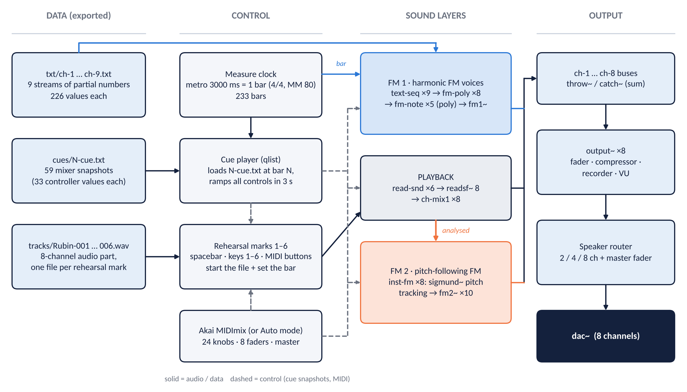

*Figure 1 — Overview. Blue = FM 1, grey = playback, orange = FM 2. Dashed lines are control data (cue snapshots, MIDI), solid lines are data or audio.*

| Part | Pd objects (abstractions) | Role |
|---|---|---|
| Measure clock | `pd measures-metro` | counts bars, stops at bar 233 |
| Marks | `pd stepper`, `pd measures`, `pd set-cue-no` | start file *n*, set the bar number |
| Cue player | `pd qlists` | loads `N-cue.txt` at bar *N* |
| Controller | `midimix`, `midimix-col`, `knob` | Akai MIDImix → knobs and faders, also driven by the cues |
| Playback | `read-snd` ×6, `ch-mix1` ×8 | 8-channel files from `tracks/` |
| FM 1 | `text-seq` ×9, `fm-poly` ×8, `fm-note` ×5, `fm1~`, `ch-mix2` ×8 | harmonic FM voices from `txt/ch-N.txt` |
| FM 2 | `inst-fm` ×8, `fm2~` ×10 | FM that follows the pitches of the playback |
| Output | `output~` ×8, `pd speaker`, `main-out~` | fader, compressor, recorder, 2/4/8-speaker router |

---

## 2. Time: one clock, six marks, 59 cues

### The bar clock

`pd measures-metro` contains a `[metro 3000]` — one tick every three seconds, which is one 4/4 bar at ♩ = 80. A counter sends the bar number to everything that needs to know "where are we": the number streams (`text-seq`), the cue player (`qlists`) and the GUI. At the end of the score (bar 233) the counter stops. The whole piece is 233 × 3 s ≈ 11 min 39 s long.

### Rehearsal marks

The six marks of the score re-start the clock at a fixed bar and open the matching audio file:

| Mark | Bar | Time | Audio file |
|---|---|---|---|
| 1 | 1 | 0:00 | `Rubin-001.wav` |
| 2 | 43 | 2:06 | `Rubin-002.wav` |
| 3 | 67 | 3:18 | `Rubin-003.wav` |
| 4 | 98 | 4:51 | `Rubin-004.wav` |
| 5 | 148 | 7:21 | `Rubin-005.wav` |
| 6 | 177 | 8:48 | `Rubin-006.wav` |

The operator presses the **spacebar** at each rehearsal mark (backspace goes back one mark). Because the bar counter is *reset* at every mark, small timing errors of the conductor never accumulate: the electronics are re-synchronised six times per performance.

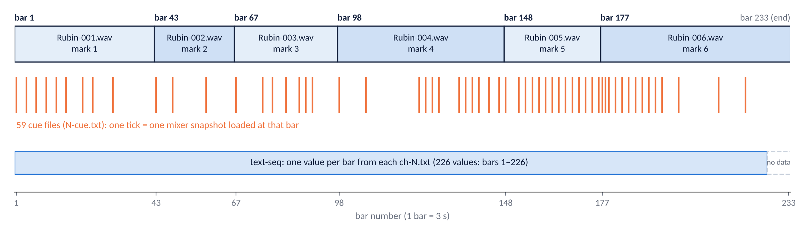

*Figure 2 — The time structure. Each of the six audio files covers one section; the orange ticks are the bars at which a cue file exists; the number streams run for 226 bars.*

### Keys and controls

| Key / control | Action |
|---|---|
| `o` | DSP on / off |
| spacebar / backspace | next / previous rehearsal mark (starts the file and sets the bar) |
| `1` … `6` | select a rehearsal mark directly |
| `m` | mute playback and FM (stops the files and the clock, fades the FM voices) |
| `a` | manual / automatic (cues on or off) |
| Akai *Bank Left / Right* | step marks back / forward from the controller |

To jump to a mark during rehearsal: press `m`, choose the mark with `1`–`6`, press the spacebar.

---

## 3. Layer FM 1 — harmonic FM from number streams

### From the composition to Pd

The Opusmodus composition exports **nine text files**, `ch-1.txt` … `ch-9.txt`. Each contains 226 integers, one per bar (bars 1–226), separated by semicolons. In the patch they are *partial numbers*: multipliers of the fundamental **f₀ = 24.4997 Hz** (twice 12.2499 Hz, the fundamental of the harmonic field in the composition).

All streams start on 2 (= 49 Hz, g1). Like a spectrum opening and closing, they fan out until bar ≈ 160 and converge again towards the end. Stream 1 reaches partial 32 (784 Hz); stream 9 never exceeds 6.

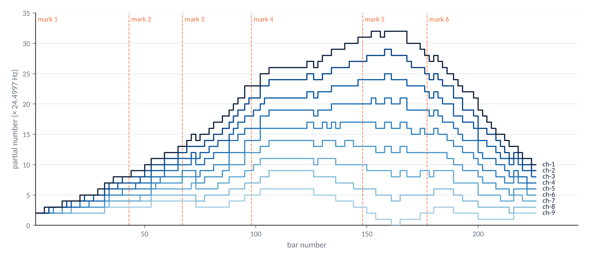

*Figure 3 — The nine partial-number streams over the 226 bars. All start on partial 2, spread to the maximum around bars 150–170, and close again.*

### `text-seq`: one value per bar

Nine instances of `text-seq` each hold one file in a `[text define]` object. At every bar they look up the value for the current bar and send it, together with their stream number, to a global bus: `[s freq]` with the message *stream value*.

### `fm-poly`: pairing neighbouring streams

Eight instances of `fm-poly` listen on that bus. Voice *i* picks up **two** streams:

- the stream with the same number *i* → **modulator partial**,
- the stream *i* + 1 → **carrier partial** *and* the trigger for a new note.

Nine streams therefore make eight voices, and every voice leaves through its own output channel (voice *i* → `ch-i`). The carrier is always the lower stream, so the pitch of the voice is carried by the lower line while the line above it controls the brightness.

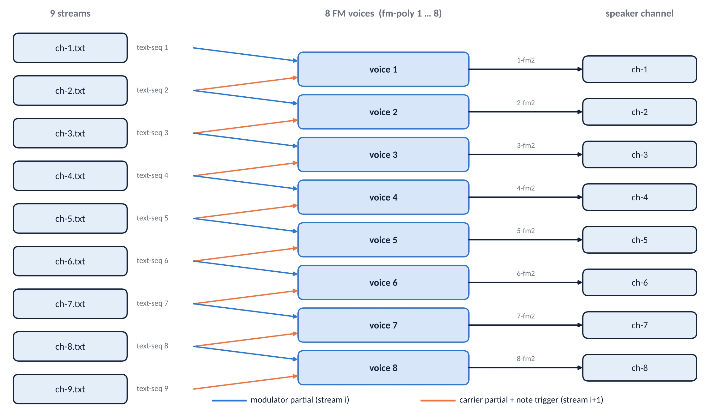

*Figure 4 — Voice i takes its modulator from stream i and its carrier (and the trigger) from stream i+1. A one-millisecond delay makes sure both values of a bar have arrived before the note is started.*

### `fm1~`: the FM engine

The engine is a classic two-oscillator FM voice written as an abstraction:

- carrier frequency = f₀ × *carPartial*,
- modulator frequency = f₀ × *modPartial*,
- modulation depth in Hz = f₀ × *index* × *LFNoise*,
- *LFNoise* = a random value between 0 and 1 that glides linearly to a new value every few seconds.

The resulting **FM index** is roughly β = index × LFNoise ÷ modPartial. It means that the timbre *breathes* slowly, and that a high modulator partial (a high stream) produces a *less* dense spectrum than a low one.

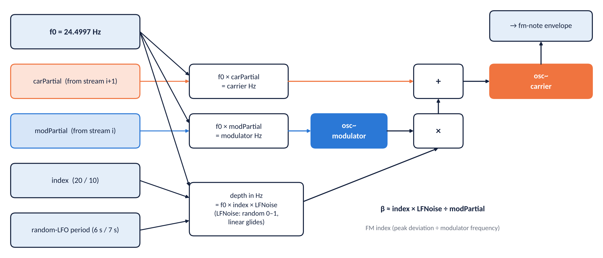

*Figure 5 — The `fm1~` abstraction.*

Each note uses **two** `fm1~` oscillator pairs, summed:

| Pair | Modulator | Index | Random LFO |
|---|---|---|---|
| A | stream value (integer ratio) | 20 | 6 s |
| B | carrier partial + 0.01 (almost 1 : 1) | 10 | 7 s |

Because carrier and modulator are integer multiples of f₀, pair A keeps its sidebands on the harmonic series. Pair B is deliberately a little *off* the integer ratio, which adds slow beating and shimmer.

### Polyphony and envelopes

Every bar a new note starts in each voice. `fm-note` is instantiated five times per voice; a slot counter (1 → 5 → 1 …) hands each new note to the next slot in turn. Each note has its own envelope: **3 s attack, 6 s release** (9 s in total). Since a note starts every 3 s, about three notes sound at the same time in every voice. The result is a slowly turning harmonic cloud rather than a melody: each new bar adds a swelling note on top of the fading previous ones.

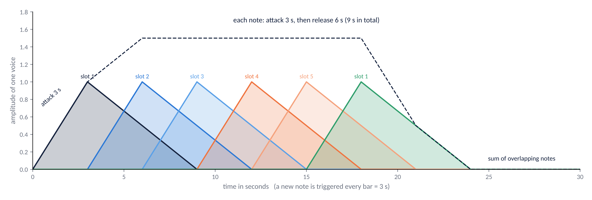

*Figure 6 — The envelopes of consecutive notes in one voice. The dashed line shows how the notes add up.*

---

## 4. Layer Playback — the 8-channel audio part

Six `read-snd` instances wait for the mark number. When mark *n* is selected, `readsf~ 8` opens `tracks/Rubin-00n.wav` and plays all **8 channels** into a shared bus. A small `pd mix-playback` distributes the eight channels to eight `ch-mix1` strips, each with its own level (knob row 1 of the controller).

Three details are worth knowing:

- Playback and clock are started by the same event, but nothing keeps them locked afterwards; the next mark re-synchronises them.
- Each channel is also sent, *before* its fader, to the FM 2 layer (next section). The audience can therefore hear FM 2 even if the playback fader is closed.
- An optional input `pd reaper-out` (`adc~` with 8 channels) can replace the files, for example to rehearse with a DAW. It is switched off by default.

---

## 5. Layer FM 2 — FM that follows the playback

`inst-fm` (eight instances, one per playback channel) is a *pitch follower*: it listens to the channel and answers each detected note with a slow inharmonic FM tone.

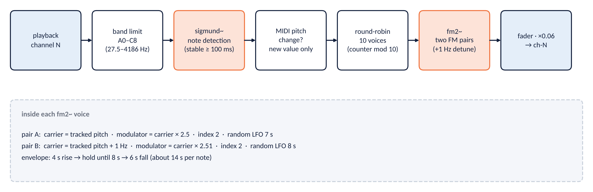

*Figure 7 — The pitch-following chain of one channel.*

1. The channel is band-limited to A0 – C8 (27.5 – 4186 Hz).
2. `sigmund~` (4096-point analysis, stable time 100 ms) reports **notes** as MIDI pitches.
3. Only a *changed* pitch passes (`change`), so a held or repeated note does not retrigger.
4. A counter distributes the notes round-robin to **ten** `fm2~` voices.
5. Each `fm2~` voice has two FM pairs at the tracked pitch (the second 1 Hz higher) with modulator ratios **2.5** and **2.51**, index 2 and random LFOs of 7 s and 8 s. Non-integer ratios make the spectrum *inharmonic*, bell-like and beating.
6. Envelope: 4 s rise, hold until 8 s, 6 s fall.

Compositionally, FM 1 and FM 2 are opposites: FM 1 stays strictly on the harmonic series of 24.4997 Hz and follows numbers; FM 2 follows whatever pitches the instruments and the playback actually produce and colours them inharmonically.

---

## 6. The mixing score: knobs, faders and cue files

### The control surface

The Akai MIDImix has 24 knobs, 8 channel faders and a master fader. They are used as a **three-layer mixer**:

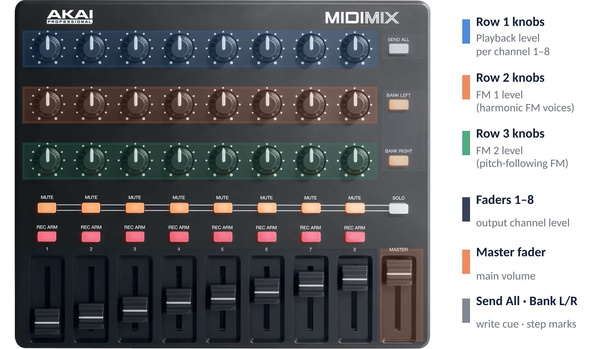

*Figure 8 — Assignment of the controls.*

| Control | Controller numbers | Function |
|---|---|---|
| Knob row 1 (×8) | cc 16, 20, 24, 28, 46, 50, 54, 58 | playback level, channels 1–8 |
| Knob row 2 (×8) | cc 17, 21, 25, 29, 47, 51, 55, 59 | FM 1 level, channels 1–8 |
| Knob row 3 (×8) | cc 18, 22, 26, 30, 48, 52, 56, 60 | FM 2 level, channels 1–8 |
| Faders 1–8 | cc 19, 23, 27, 31, 49, 53, 57, 61 | output level, channels 1–8 |
| Master fader | cc 62 | main volume |

### Cue files

A cue file is a plain text file named after a bar. It contains **33 lines**, one for every controller, in the form `cc-<number> <value> <fade time>`:

```text
cc-16 127 3000;
cc-17 0 3000;
cc-18 0 3000;
cc-19 70 3000;
…
cc-62 70 3000;
```

When the clock reaches bar *N*, the cue player checks whether `N-cue.txt` exists. If it does, all 33 controls move to their stored values within **3 seconds**, exactly as if a hand had moved them. There are 59 cue files, from bar 1 to bar 220. With **Man/Auto** set to *manual*, the cues are ignored and the Akai is played by hand.

### What the cues compose

Plotted over the 233 bars, the cues show the large-scale mix of the piece:

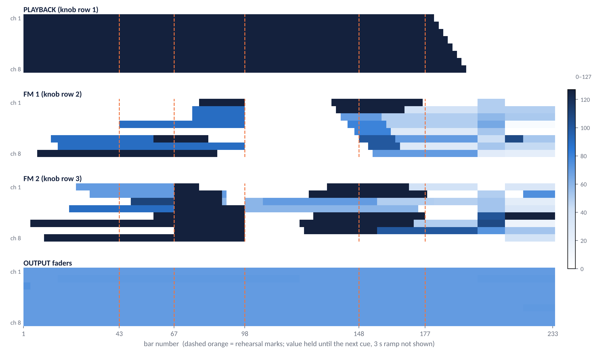

*Figure 9 — Knob and fader values stored in the 59 cues (white = 0, dark = 127). Each value is held until the next cue.*

- **Playback** is at full level on all eight channels from the start. Between bars ≈ 179 and 195 it is faded out channel by channel, in two-bar steps, from channel 1 to channel 8. After that only the two FM layers remain.
- **FM 2** enters channel by channel during the first section (first appearances on bars 4, 10, 21, 24, 30, 48, 58 and 67).
- **FM 1** enters from bar 7 onwards, is closed on all channels between roughly bars 98 and 134, and returns for the last third of the piece.
- The **output faders** hardly move (values 70–74): balance is handled by the layer knobs, not by the output stage.

### Writing new cues

The same mechanism works in reverse. To record a cue: type the bar number into the *Set number of qlist file* box, set all knobs and faders, and press **Send All** on the MIDImix. The patch writes `N-cue.txt` into the `cues/` folder.

---

## 7. Output: channel strip, master and loudspeakers

All layers feed eight summing buses `ch-1` … `ch-8` (`throw~` / `catch~`). Each bus passes through `output~`:

1. fader (from the Akai) with a short ramp,
2. optional **compressor** (RMS/peak, switchable per channel),
3. level meter (VU),
4. optional **recording** of the channel as a 24-bit WAV file into `rec/` (`C` = record on/off, `R` = reset the file number).

The eight signals then enter `pd speaker`, which applies the **master fader** and routes them to one of three loudspeaker layouts. The three layouts are crossfaded in 20 ms, so switching during a rehearsal is click-free:

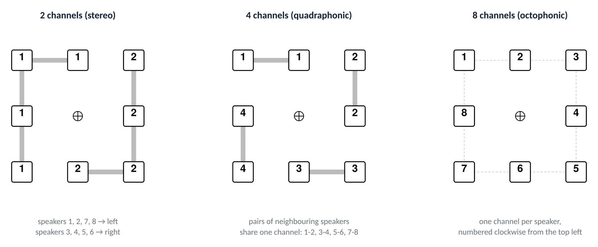

*Figure 10 — Speaker setups. The piece is written for four channels (quadraphonic); the 2- and 8-channel layouts are provided for small and large rooms.*

A built-in **speaker test** (white-noise bursts, one channel every 1.5 s) checks the wiring of the 2, 4 or 8 channel setup before the concert.

---

## 8. Running a performance

**Set-up (once)**

1. Install Pure Data vanilla (the patch was made with 0.56-2); put the six `Rubin-00n.wav` files into `tracks/`.
2. Open `@main.pd`.
3. *Media → Audio Settings*: sample rate 48000, delay 10 ms, audio interface, 8 channels.
4. *Media → MIDI Settings*: select the MIDI Mix as input and output device.
5. Choose the loudspeaker layout (2 / 4 / 8) and run the speaker test; switch the test off again.
6. For larger rooms: amplify the instruments and send them to the front speakers.

**During the concert**

1. Press `o` (DSP on) and bring up the master fader.
2. Spacebar starts mark 1 (bar 1).
3. Spacebar again at each of the five following rehearsal marks.
4. Nothing else is needed: knobs and faders move by themselves (*Auto* mode).

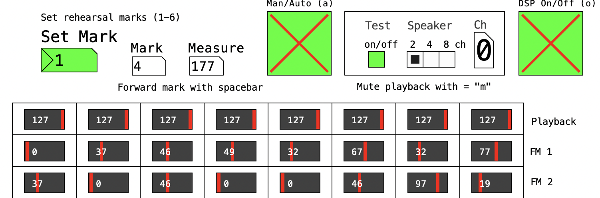
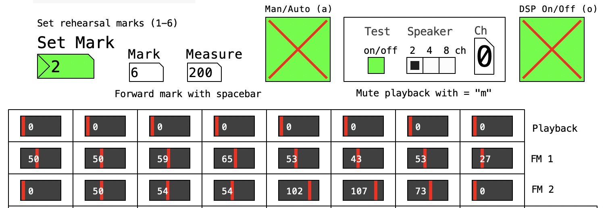

*Figures 11 and 12 — Screenshots of the patch at bar 177 (playback still at 127) and at bar 200 (playback closed, the two FM layers carry the music).*

---

## 9. File map

| Folder / file | Content |
|---|---|
| `@main.pd` | main patch, all GUI elements and key handling |
| `abs/` | abstractions: `text-seq`, `fm-poly`, `fm-note`, `fm1~`, `fm2~`, `inst-fm`, `read-snd`, `ch-mix1/2`, `output~`, `main-out~`, `midimix*`, `knob`, `speaker-test` |
| `txt/` | `ch-1.txt` … `ch-9.txt` (number streams), `init.txt` (start values of knobs and faders) |
| `cues/` | 59 files `N-cue.txt` (mixer snapshots) |
| `tracks/` | `Rubin-001.wav` … `Rubin-006.wav` (8-channel audio part) |
| `rec/` | output recordings (created by `output~`) |
| `sco/Rubin.pdf` | score |
| `img/`, `@rubin-cues/` | controller photos, settings screenshots, speaker diagrams, GUI screenshots |
| `README.html` | user documentation of the patch |

---

## 10. Points to check

These observations come from reading the patch files. They are noted here because they could be intended or accidental.

- **Partial numbers.** The values in `ch-N.txt` are used by Pd directly as integer multipliers of 24.4997 Hz. If the Lisp export contains *ids* (positions in the 33-pitch material) instead, Pd has no lookup table, and the pitches would not be those of the composition.
- **Stream 9 contains four zeros.** A carrier partial of 0 means 0 Hz, i.e. a silent step in voice 8.
- **226 values, 233 bars.** The streams end 7 bars before the clock stops; the last bars of FM 1 are therefore silent apart from the release tails.
- **Reverb.** `output~` contains a `pd reverb` subpatch that is not connected to the signal path.
- **File names.** `read-snd` opens `rubin-00N.wav` (lower case) while the files are called `Rubin-00N.wav`. This works on macOS and Windows, not on case-sensitive file systems.
